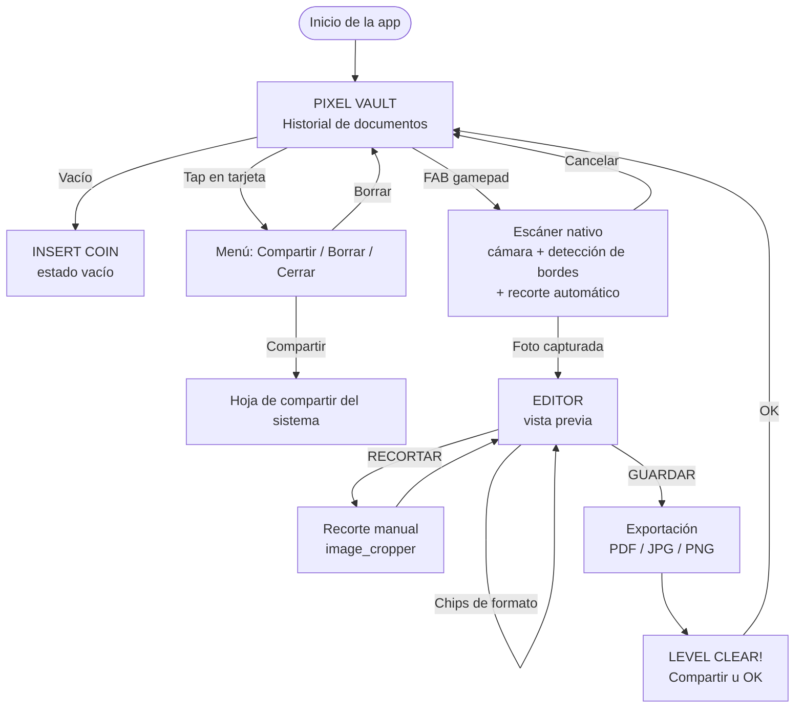

# 🎮 Pixel PVR — Anotaciones de Arquitectura, UI/UX y Flujo

Escáner de documentos móvil con estética **Retro Pixel Art** (8/16 bits), construido con **Flutter**, **Clean Architecture + MVVM** y preparado para integrar **Firebase** en versiones futuras.

> Este documento acompaña a `pixel_pvr_codigo_completo.dart`, que contiene todo el código del MVP en un solo archivo con marcadores `// ▓▓▓ ARCHIVO: lib/...` para separarlo en carpetas.

---

## 1. Resumen del MVP

| # | Requisito | Cómo se resuelve |
|---|-----------|------------------|
| 1 | Pantalla "Pixel Vault" con historial en tarjetas pixel art | `VaultPage` + `_TarjetaDocumento` sobre `PixelBox`; datos en Hive |
| 2 | Botón flotante tipo juego con cámara, detección de bordes y recorte auto | `PixelFab` (gamepad) + `NativoEscanerService` (`cunning_document_scanner`: ML Kit en Android, VisionKit en iOS) |
| 3 | Edición: filtros, recorte/perspectiva manual, formato de salida | `EditorPage` + `ImageProcessingService` (paquete `image`) + `image_cropper` |
| 4 | Exportación y guardado local | `ExportarDocumento` (caso de uso) + `PdfExportService` + `FileStorageService` |
| 5 | Arquitectura desacoplada para Firebase | Repositorio abstracto + datasources + inyección con `provider` |

---

## 2. Dependencias (`pubspec.yaml`)

```yaml
dependencies:
  flutter:
    sdk: flutter
  provider: ^6.1.2
  hive: ^2.2.3
  hive_flutter: ^1.1.0
  google_fonts: ^6.2.1
  cunning_document_scanner: ^1.2.4
  image_cropper: ^8.0.2
  image: ^4.2.0
  pdf: ^3.11.1
  path_provider: ^2.1.4
  share_plus: ^10.1.0
```

**Notas**
- Las versiones son referencia; ejecuta `flutter pub upgrade --major-versions` y revisa breaking changes.
- `share_plus` cambió su API en versiones recientes (`SharePlus.instance.share(ShareParams(...))`). El código usa `Share.shareXFiles` (serie 10.x). Si actualizas, ajusta esas 2 llamadas.
- **Fuentes**: `google_fonts` descarga *Press Start 2P* y *VT323* en runtime y las cachea. Para uso 100 % offline desde el primer arranque, descarga los `.ttf`, decláralos en `pubspec.yaml` (`fonts:`) y usa `TextStyle(fontFamily: 'PressStart2P')`.

---

## 3. Estructura de carpetas recomendada

Organizada **por feature** y, dentro de cada una, por **capa** (domain / data / presentation).

```
lib/
├── main.dart                         # Inicializa Hive y arranca la app
├── app.dart                          # MaterialApp + MultiProvider (composition root)
│
├── core/                             # Transversal, sin lógica de negocio
│   ├── theme/
│   │   ├── pixel_colors.dart         # Paleta Neon Arcade
│   │   └── pixel_theme.dart          # ThemeData + estilos de texto
│   ├── widgets/
│   │   ├── pixel_box.dart            # Contenedor escalonado + sombra dura
│   │   ├── pixel_button.dart         # Botón arcade
│   │   ├── pixel_fab.dart            # FAB gamepad
│   │   └── pixel_dialog.dart         # Diálogos retro
│   ├── services/
│   │   └── file_storage_service.dart # Lectura/escritura de archivos locales
│   └── utils/
│       └── formatters.dart           # Fecha, tamaño, nombre automático
│
└── features/
    ├── vault/                        # Historial
    │   ├── domain/
    │   │   ├── entities/documento_escaneado.dart
    │   │   └── repositories/documento_repository.dart      # Contrato (abstract)
    │   ├── data/
    │   │   ├── datasources/documento_local_datasource.dart # Hive
    │   │   └── repositories/documento_repository_impl.dart
    │   └── presentation/
    │       ├── viewmodels/vault_viewmodel.dart
    │       └── pages/vault_page.dart
    │
    ├── scanner/                      # Captura con cámara
    │   └── data/services/escaner_service.dart              # Abstract + implementación nativa
    │
    ├── editor/                       # Filtros, recorte, formato
    │   ├── data/services/image_processing_service.dart
    │   └── presentation/
    │       ├── viewmodels/editor_viewmodel.dart
    │       └── pages/editor_page.dart
    │
    └── export/                       # Conversión y guardado
        ├── data/services/pdf_export_service.dart
        └── domain/usecases/exportar_documento.dart
```

### Cómo separar el archivo único
Busca cada marcador `// ▓▓▓ ARCHIVO: ruta ▓▓▓` en el código: todo lo que sigue hasta el siguiente marcador va en esa ruta. Al separar, agrega los `import` necesarios en cada archivo (el IDE los sugiere con *Quick Fix*) y reemplaza las referencias entre archivos por imports relativos.

### Regla de dependencias (Clean Architecture)
```
presentation  →  domain  ←  data
   (UI/VM)     (entidades,   (Hive, ML Kit,
               contratos,     PDF, archivos)
               casos de uso)
```
- `domain` **no importa** Flutter, Hive ni paquetes de plataforma.
- `presentation` solo conoce contratos (`DocumentoRepository`, `EscanerService`), nunca implementaciones.
- `app.dart` es el único lugar que "conecta" contratos con implementaciones.

---

## 4. Guía de estilo visual

### 4.1 Paleta "Neon Arcade"

| Token | Hex | Uso |
|-------|-----|-----|
| `fondo` | `#14122B` | Fondo general (azul noche) |
| `superficie` | `#2A2750` | Tarjetas y paneles |
| `superficieAlta` | `#3B3870` | Elementos elevados / deshabilitados |
| `magenta` | `#FF2E93` | Acción principal (FAB, Guardar, PDF) |
| `cian` | `#00F5D4` | Selección, títulos, enlaces |
| `amarillo` | `#FEE440` | Destacados, JPG, Recortar |
| `verde` | `#9EF01A` | Éxito, PNG |
| `texto` | `#F4F1FF` | Texto y bordes |
| `textoSuave` | `#9D9AC9` | Texto secundario |
| `sombra` | `#000000` | Sombra dura |

Contraste: texto negro sobre magenta/cian/amarillo/verde y texto claro sobre fondos oscuros cumple WCAG AA en los tamaños usados.

### 4.2 Tipografía

| Rol | Fuente | Tamaño | Uso |
|-----|--------|--------|-----|
| Títulos / botones / chips | **Press Start 2P** | 8–16 px | AppBar, etiquetas, botones |
| Lectura / metadatos | **VT323** | 16–22 px | Descripciones, fechas, mensajes |

Press Start 2P es muy ancha: mantenerla en 8–12 px y en mayúsculas. VT323 es la opción para frases largas.

### 4.3 Bordes y "píxeles"
- **Esquinas escalonadas** (no `BorderRadius`): un escalón de `pixel` px (4 por defecto) en cada esquina, dibujado con `Path` en `CustomPainter`.
- **Borde**: trazo de `pixel / 2` px, color `borde`.
- **Sombra dura**: copia del contorno desplazada 4 px en x/y, color negro, sin blur.
- **Antialiasing desactivado** (`isAntiAlias = false`) para bordes nítidos.
- **Imágenes pixeladas**: `FilterQuality.none` en miniaturas y en el filtro Pixel Art.

### 4.4 Componentes

| Componente | Comportamiento |
|------------|----------------|
| `PixelBox` | Base de todo. Parámetros: `color`, `borderColor`, `pixel`, `shadow`, `padding` |
| `PixelButton` | Al presionar se desplaza 3 px y reduce la sombra (efecto "hundirse"). Deshabilitado = gris |
| `PixelFab` | Botón magenta de 6 px de escalón con ícono de gamepad; sombra más grande |
| `_PixelChip` | Seleccionado = cian sin sombra ("presionado"); no seleccionado = superficie con sombra |
| `mostrarPixelDialogo` | Diálogo con `PixelBox`, título en Press Start 2P y acciones como botones |

### 4.5 Microcopy retro
`INSERT COIN` (vault vacío) · `HI-SCORE` (contador) · `LEVEL CLEAR!` (guardado exitoso) · `CARGANDO...` / `GUARDANDO...`. Evita acentos en textos con Press Start 2P (la fuente no cubre todos los diacríticos).

### 4.6 Ideas para siguientes iteraciones visuales
- Overlay de *scanlines* sutil con `CustomPainter` (opacidad 5–8 %).
- Sonidos 8-bit (`audioplayers`) al escanear/guardar, con opción para silenciar.
- Animación de sprites con `AnimatedBuilder` en el estado vacío.
- Modo claro "Game Boy" (paleta verde de 4 tonos) como tema alterno.

---

## 5. Flujo de pantallas (User Flow)



### Detalle por pantalla

**1. Pixel Vault (home)**
- Cuadrícula de 2 columnas con miniatura, nombre, etiqueta de formato (color por tipo) y fecha.
- Encabezado con contador de documentos.
- FAB inferior derecho para escanear.

**2. Escáner (nativo)**
- Detección automática de bordes, corrección de perspectiva y recorte.
- El usuario puede **ajustar las esquinas** (perspectiva manual) dentro de la propia UI nativa.
- Permite importar desde galería.

**3. Editor**
- Vista previa con zoom (`InteractiveViewer`, hasta 5×).
- Filtros: `ORIGINAL`, `COLOR+`, `B/N`, `GRISES`, `PIXEL`.
- Formato de salida: `PDF`, `JPG`, `PNG`.
- Acciones: `RECORTAR` (ajuste manual) y `GUARDAR`.
- Caché de filtros ya calculados: cambiar entre ellos es instantáneo.

**4. Exportación**
- Convierte, guarda archivo y miniatura, registra en Hive y muestra confirmación.

---

## 6. Modelo de datos local

### 6.1 Entidad `DocumentoEscaneado`

| Campo | Tipo | Descripción |
|-------|------|-------------|
| `id` | `String` | `microsecondsSinceEpoch` (único, ordenable) |
| `nombre` | `String` | Ej. `SCAN_20261012_1930` |
| `creadoEn` | `DateTime` | Se guarda en ISO-8601 |
| `rutaArchivo` | `String` | Archivo final (PDF/JPG/PNG) en el directorio de la app |
| `rutaMiniatura` | `String` | JPG de 240 px de ancho para el vault |
| `formato` | `FormatoExportacion` | `pdf` \| `jpg` \| `png` |
| `filtro` | `FiltroImagen` | Filtro aplicado (informativo) |
| `tamanoBytes` | `int` | Tamaño del archivo final |
| `paginas` | `int` | 1 en el MVP (preparado para multipágina) |
| `schemaVersion` | `int` (solo en mapa) | Para migraciones futuras |

### 6.2 Persistencia (Hive sin codegen)
- Box `pixel_vault` de tipo `Box<String>`: **clave** = `id`, **valor** = JSON del documento.
- Ventaja: sin `build_runner` ni `TypeAdapter`, migración trivial.
- Orden: descendente por `creadoEn` al leer.
- Los archivos viven en `<documentos de la app>/pixel_vault/`:
  - `<id>.pdf|jpg|png`
  - `<id>_thumb.jpg`
- Al eliminar un registro se borran **ambos** archivos (`DocumentoRepositoryImpl.eliminar`).

### 6.3 Alternativa con Isar

```dart
@collection
class DocumentoIsar {
  Id isarId = Isar.autoIncrement;

  @Index(unique: true, replace: true)
  late String id;

  late String nombre;

  @Index()
  late DateTime creadoEn;

  late String rutaArchivo;
  late String rutaMiniatura;

  @Enumerated(EnumType.name)
  late FormatoExportacion formato;

  @Enumerated(EnumType.name)
  late FiltroImagen filtro;

  late int tamanoBytes;
  late int paginas;
}
```
Solo habría que crear `DocumentoIsarDataSource` y cambiar la línea del `Provider<DocumentoRepository>` en `app.dart`. Dominio y UI no se tocan. Isar aporta consultas indexadas (búsqueda por nombre, filtros por fecha/formato) si el historial crece mucho.

---

## 7. Arquitectura y puntos de extensión

### 7.1 MVVM con `provider`
- **View**: `VaultPage`, `EditorPage` (solo UI, leen estado con `watch`, disparan acciones con `read`).
- **ViewModel**: `VaultViewModel`, `EditorViewModel` (`ChangeNotifier`, estado + orquestación).
- **Model/Domain**: entidad, repositorio abstracto, caso de uso `ExportarDocumento`.
- El `EditorViewModel` se crea **por pantalla** (se destruye al salir); el `VaultViewModel` es **global**.

### 7.2 Rendimiento
- Filtros, codificación y miniaturas corren en **isolates** (`compute`) → la UI no se congela.
- La imagen se reduce a **1600 px de ancho máximo** para la vista previa y el procesamiento.
- Caché `Map<FiltroImagen, Uint8List>` por imagen; se invalida al recortar.

### 7.3 Descripción de los filtros

| Filtro | Implementación |
|--------|----------------|
| Color optimizado | `adjustColor`: contraste 1.25, saturación 1.15, brillo 1.05 |
| Blanco y negro | Grises + contraste 1.4 + umbral fijo (140) |
| Escala de grises | `grayscale` |
| Pixel Art Retro | Reducir a 120 px → cuantizar a 16 colores → escalar con vecino más cercano |

> Mejora recomendada para B/N: **umbral adaptativo** (Otsu o Sauvola) para documentos con sombras o iluminación irregular.

### 7.4 Integración futura con Firebase

El contrato `DocumentoRepository` es el punto de enganche. Plan sugerido:

1. **Auth**: nueva feature `auth/` con `AuthRepository` (anónimo → email/Google).
2. **Nube**: `DocumentoRemoteDataSource`
   - Metadatos → **Cloud Firestore** (`users/{uid}/documentos/{id}`), mismo mapa que `toMap()`.
   - Archivos → **Firebase Storage** (`users/{uid}/documentos/{id}.ext`).
3. **Repositorio híbrido**: `DocumentoRepositoryHybrid implements DocumentoRepository`
   - **Offline-first**: escribe en Hive y encola subida; lee siempre de local.
   - Campos nuevos sugeridos: `syncEstado` (`pendiente|sincronizado|error`), `remoteUrl`, `actualizadoEn`.
4. **Cambio en `app.dart`**: reemplazar el `Provider<DocumentoRepository>`; la UI no cambia.
5. Opcional: **Crashlytics**, **Analytics**, **Remote Config** (feature flags para filtros nuevos).

Pasos de configuración: `flutterfire configure`, `Firebase.initializeApp()` en `main()`, y reglas de Firestore/Storage que limiten el acceso a `request.auth.uid == userId`.

---

## 8. Configuración de plataformas

### Android
`android/app/build.gradle`:
```gradle
defaultConfig {
    minSdkVersion 21   // el escáner ML Kit requiere API 21+
}
```
`AndroidManifest.xml` (dentro de `<manifest>`):
```xml
<uses-permission android:name="android.permission.CAMERA"/>
```
`image_cropper` requiere declarar su actividad:
```xml
<activity
    android:name="com.yalantis.ucrop.UCropActivity"
    android:screenOrientation="portrait"
    android:theme="@style/Theme.AppCompat.Light.NoActionBar"/>
```
> El escáner ML Kit descarga su módulo mediante Google Play Services la primera vez; requiere dispositivo con Play Services y conexión en el primer uso.

### iOS
`ios/Runner/Info.plist`:
```xml
<key>NSCameraUsageDescription</key>
<string>Pixel PVR necesita la cámara para escanear documentos.</string>
<key>NSPhotoLibraryUsageDescription</key>
<string>Pixel PVR necesita acceso a tus fotos para importar documentos.</string>
```
VisionKit requiere **iOS 13+**.

---

## 9. Limitaciones conocidas del MVP

| Limitación | Detalle | Camino de mejora |
|------------|---------|------------------|
| Perspectiva manual | `image_cropper` hace recorte rectangular; las esquinas libres solo se ajustan dentro del escáner nativo | Pantalla propia con 4 puntos arrastrables + `opencv_dart` (`warpPerspective`) |
| Un documento = una página | `paginas` ya existe en el modelo | `noOfPages > 1` en el escáner + `pw.Page` por imagen |
| Guardado en la carpeta privada de la app | El archivo no aparece en la galería | Añadir "Guardar en galería/Descargas" con `gal` o `saver_gallery` |
| B/N con umbral fijo | Sensible a sombras | Umbral adaptativo |
| Sin OCR | — | `google_mlkit_text_recognition` para PDF buscable |
| Sin renombrar ni buscar | Nombre automático | Campo de nombre en el editor + búsqueda en el vault |

---

## 10. Pruebas sugeridas

- **Unitarias**: `DocumentoEscaneado.toMap/fromMap` (round-trip y valores desconocidos de enum), `formatearTamano`, `nombreAutomatico`.
- **Dominio/uso de casos**: `ExportarDocumento` con repositorio y servicios *fake* (verificar extensión, registro y miniatura).
- **ViewModels**: `EditorViewModel` (caché de filtros, invalidación al recortar, manejo de errores).
- **Widget**: `VaultPage` en estados vacío / con datos / cargando (golden tests por el estilo visual).
- **Integración**: flujo completo con `EscanerService` simulado que devuelve una imagen de prueba.

---

## 11. Checklist para arrancar

1. `flutter create pixel_pvr` y pega las dependencias en `pubspec.yaml`.
2. Copia `pixel_pvr_codigo_completo.dart` a `lib/main.dart` (ejecuta tal cual) **o** sepáralo por carpetas con los marcadores.
3. Configura permisos de Android e iOS (sección 8).
4. `flutter pub get` → `flutter run` en un **dispositivo físico** (el escáner no funciona en emuladores sin cámara).
5. Revisa la sección 9 para decidir las primeras mejoras del backlog.

---

## 12. Roadmap sugerido

| Versión | Contenido |
|---------|-----------|
| **0.1 (MVP)** | Lo entregado en este código |
| **0.2** | Multipágina, renombrar, búsqueda, guardar en galería |
| **0.3** | Perspectiva manual propia (OpenCV), B/N adaptativo, OCR |
| **0.4** | Firebase Auth + sincronización offline-first |
| **0.5** | Temas alternos (Game Boy), sonidos 8-bit, logros ("achievements") |
